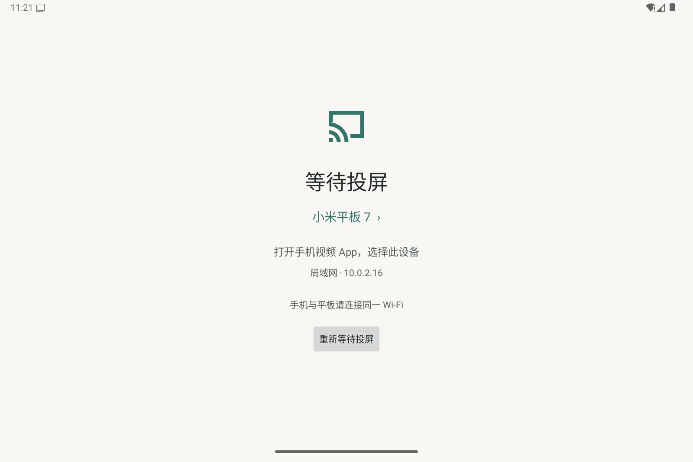

# 平板投屏 0.1

用于小米平板 7 / Android 16 的极简 DLNA MediaRenderer 测试版。原生 Android 界面，Media3 ExoPlayer 播放 HTTP(S)、HLS、DASH 媒体，SSDP 设备发现，SOAP 控制和 GENA 状态通知。无账号、广告和分析服务。

[下载测试版 APK](https://github.com/reny736/androidTV/raw/refs/heads/main/dist/TabletCast-0.1.0.apk) · [测试说明](dist/测试说明.md) · [SHA-256 校验](dist/TabletCast-0.1.0.apk.sha256)

## 核心结构

- `MainActivity.java`：原生 Android 界面、Media3 播放、错误提示与生命周期管理。
- `DlnaServer.java`：SSDP 发现、设备描述、SOAP 播放控制和 GENA 状态通知。
- `ServiceDescription.java`：生成三个 UPnP 服务的能力描述。
- `app/src/main/java/fi/iki/elonen/NanoHTTPD.java`：内置 HTTP 服务，补齐 DLNA 订阅方法支持。
- `tests/pc-smoke.py`：使用自制视频执行模拟器基础检查。
- `dist/`：已测试的 APK、校验文件和安装说明。

实现语言为 Java，最低 Android 8.0，目标 SDK 35。构建工具、SDK、模拟器镜像、签名密钥和运行日志均不纳入仓库。

## 安装与测试

1. 将 `dist/TabletCast-0.1.0.apk` 传到平板，允许文件管理器安装此来源的应用，安装并打开“平板投屏”。
2. 手机和平板连接同一路由器的局域网；不要使用访客隔离网络。高码率建议信号良好的 5GHz Wi-Fi。
3. 保持 APK 在前台。在手机咪咕视频 / 哔哩哔哩的视频播放器里点击投电视，选择“小米平板 7”。支持点击等待页的设备名称修改名称。
4. 测试开始播放、暂停、拖动、切换视频、结束投屏。分别测试普通视频、直播和会员视频，记录差异。
5. 在手机支持的情况下选择高清档位，持续播放至少 20 分钟，观察缓冲、掉帧和音画同步。没有真实片源测量前不宣称 4K 或某个码率已经通过。

搜不到设备：确认同网、平板前台运行、关闭路由器 AP 隔离，点击“重新等待投屏”。重连 Wi-Fi 会重新启动发现服务。

搜得到但播放失败：记录手机 App 版本、视频类别、选定清晰度、界面提示及是否所有视频都失败。详细错误码会写入 TabletCast 日志。带鉴权、DRM 或平台专属投屏协议的内容可能无法播放。

## 范围

- 直接播放手机提供的媒体地址，不转码，不人为设定清晰度上限。实际画质由下发片源、设备解码能力和网络决定。
- 不是屏幕镜像、AirPlay 或 Google Cast 接收器，不绕过会员与 DRM。
- 无后台常驻或开机自启，测试时请保持应用前台。
- 测试版 target SDK 35，可安装于 Android 16；未启用 Android 16 可选的本地网络保护测试模式。未来提升 target SDK 时需重新评估本地网络权限。
- 调试签名 APK 仅供本地安装测试；正式发布前需独立发布签名、完整第三方许可证及实机兼容验证。
- 请求头鉴权透传和高级 DLNA 功能尚未实现。

## 电脑试运行

首次执行 `setup-emulator.ps1` 下载 Android 16 平板镜像，然后双击 `电脑试运行.cmd`。启动器会打开模拟器、等待系统启动、安装当前 APK 并打开应用。缺少虚拟化加速驱动时自动尝试软件模式，启动和操作可能较慢。

模拟器使用接近平板比例的 1600×1068 分辨率，适合检查界面与基础交互。模拟器的 NAT 网络不能代表真实平板的局域网投屏发现和高码率解码性能。

`tests/pc-smoke.py` 使用项目内 PyAV 生成本地测试视频，通过 ADB 端口转发检查设备描述、状态通知、播放、暂停、跳转、音量、停止与错误页面，截图输出到 `dist/pc-check`。需要先启动模拟器并安装 APK，且在项目目录执行 `python -m pip install --target .tools/python av==19.0.1 Pillow` 安装检查脚本的依赖。脚本面向 Windows 环境。

已在 Android 16 模拟器中通过横竖屏、设备改名对话框、基础视频播放、播放控制、状态订阅通知和错误页面检查；构建、协议描述单元测试、Android Lint 和 APK 签名验证通过。真实手机的 SSDP 发现、咪咕与哔哩哔哩平台兼容性及高码率性能仍需真机验证。

## 构建

Windows PowerShell 执行 `setup-tools.ps1` 下载项目内 JDK 17、Gradle 8.13 和 Android 命令行工具，然后执行 `build-apk.ps1` 安装 SDK 35、下载依赖、构建、运行协议描述单元测试、Lint 并验证 APK 签名。所有工具缓存保存在 `.tools`，首次构建需要网络。

源码依赖：AndroidX Media3 1.6.1（Apache-2.0）。内置 NanoHTTPD 2.3.1 源码（BSD-3-Clause），只增加 SUBSCRIBE、UNSUBSCRIBE、NOTIFY 方法枚举，以支持 DLNA GENA；其原始版权保留于源码头部及 APK 内 assets/nanohttpd-license.txt。

第三方许可证见 [THIRD_PARTY_NOTICES.md](THIRD_PARTY_NOTICES.md)。
